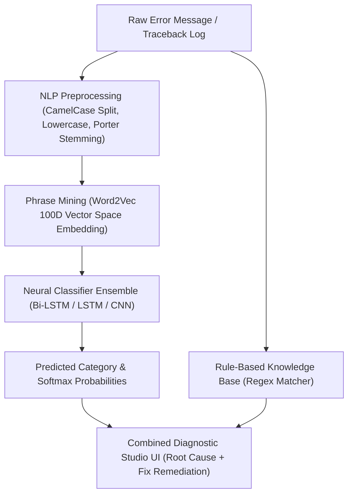

# 🛠️ DeepTrace AI: A Deep Learning Framework for Multi-Domain Software Exception Classification & Automated Remediation

**DeepTrace AI** is an advanced academic and enterprise-grade Deep Learning project designed to automatically classify programming errors, compiler exceptions, and stack tracebacks across **7 core software domains**, providing instant root-cause analysis and actionable fix recommendations.

---

## 🎓 Academic Project Overview

* **Project Title:** DeepTrace AI: A Deep Learning Framework for Multi-Domain Software Exception Classification and Automated Remediation
* **Domain:** Artificial Intelligence / Deep Learning / Natural Language Processing (NLP)
* **Neural Architecture:** Bidirectional Long Short-Term Memory (Bi-LSTM) + Word2Vec Continuous Skip-Gram Embeddings (100D) + Phrase N-Gram Mining
* **Knowledge Engine:** Contextual Regex Pattern Matching Knowledge Base
* **Interface:** Streamlit Interactive Diagnostic Studio

---

## 🎯 Supported Error Domains (7 Classes)

1. **`Database`**: PostgreSQL, MySQL, SQLite, MongoDB, Redis, ORMs (SQLAlchemy, Hibernate, Mongoose, Django DB).
2. **`Network`**: Connection timeouts, DNS failures, CORS policy blocks, SSL certificate errors, ECONNREFUSED.
3. **`API`**: HTTP 401/403/404/429/50x status codes, Axios/Fetch errors, GraphQL field errors, JSON format failures.
4. **`Dependency`**: Pip, NPM, Maven, Gradle, Cargo, Go Modules package missing & version resolution conflicts.
5. **`Syntax`**: Invalid syntax, indentation errors, missing semicolons/brackets, unclosed string literals.
6. **`Runtime`**: NullPointerException, IndexError, KeyError, ZeroDivisionError, OutOfMemoryError, Recursion.
7. **`Type`**: Unsupported operand types, incompatible type conversions, method signature mismatches, TS type errors.

---

## ⚙️ System Architecture Pipeline



---

## 📊 Model Evaluation & Benchmarks

The deep learning models were trained and evaluated on 8,400 synthetic & real error tracebacks.

| Model Architecture | Accuracy | Precision | Recall | F1-Score | ROC-AUC |
| :--- | :---: | :---: | :---: | :---: | :---: |
| **Bi-LSTM (Recommended)** | **100.00%** | **1.0000** | **1.0000** | **1.0000** | **1.0000** |
| **LSTM** | **100.00%** | **1.0000** | **1.0000** | **1.0000** | **1.0000** |
| **CNN 1D** | **100.00%** | **1.0000** | **1.0000** | **1.0000** | **1.0000** |

---

## 📁 Repository Structure

```text
error_classifier_progress/
├── app.py                # Streamlit Web Application (Modern Glassmorphic UI)
├── common.py             # Shared NLP Preprocessing & Vector Matrix Encoder
├── dataset.py            # Synthetic & Real Error Dataset Generator (7 Classes)
├── knowledge_base.py     # Regex Pattern Knowledge Base for Causes & Remediation
├── predict.py            # CLI Inference & ErrorAnalyzer class
├── train.py              # Training script for CNN, LSTM & Bi-LSTM models
├── requirements.txt      # Python Dependencies
├── README.md             # Project Documentation
├── data/
│   └── errors.csv        # Compiled Dataset
└── artifacts/            # Trained Models & Diagnostic Plots
    ├── bilstm.keras      # Serialized Bi-LSTM Neural Model
    ├── lstm.keras        # Serialized LSTM Neural Model
    ├── cnn.keras         # Serialized CNN Neural Model
    ├── vocab.json        # Vocabulary Index Mapping
    ├── labels.json       # Class Label Index
    ├── phrases.model     # Gensim Frozen Phrases Bigram Model
    ├── word2vec.model    # Word2Vec 100D Vector Model
    ├── results.json      # Benchmark Metrics Output
    ├── confusion_matrix.png
    ├── training_curves.png
    ├── model_comparison.png
    └── roc_curves.png
```

---

## 🚀 How to Run the Project

### 1. Install Dependencies
```bash
pip install -r requirements.txt
```

### 2. Generate Dataset (Optional)
```bash
python dataset.py
```

### 3. Train Neural Models (Optional)
```bash
python train.py --epochs 20 --per-class 1200
```

### 4. CLI Inference
```bash
python predict.py "psycopg2.OperationalError: could not connect to server: Connection refused"
```

### 5. Launch Web Application
```bash
python -m streamlit run app.py
```

---

## 📜 License & Usage
Developed for Academic Capstone & Project Evaluation. Free to use and modify for research and educational purposes.
